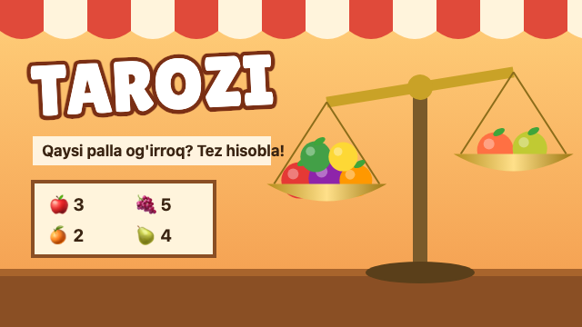
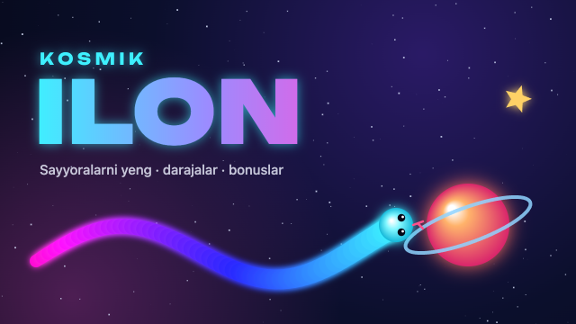
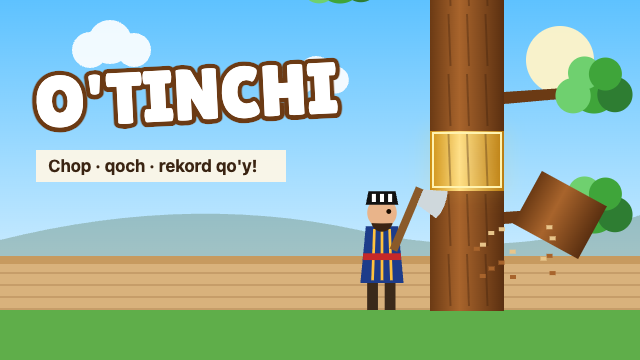
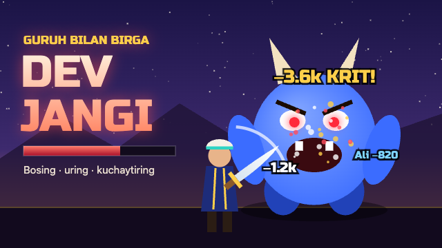
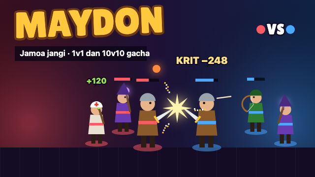
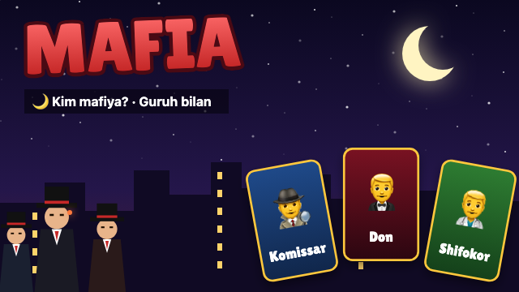

# BotFather uchun o'yinlar

Har bir o'yin @BotFather'da `/newgame` bilan bir marta ro'yxatdan o'tkaziladi:
nom, tavsif, 640×360 rasm, keyin qisqa nom. Qisqa nom aynan shunday
yozilishi kerak, bot o'yinni shu nom bilan yuboradi. Ishga tushirish
tartibi README'ning Mini App va o'yinlar bo'limida.

| Rasm | Nom | Qisqa nom | Buyruq |
|---|---|---|---|
|  | Tarozi | `tarozi` | `/game` |
|  | Kosmik ilon | `ilon` | `/ilon` |
|  | O'tinchi | `otinchi` | `/otinchi` |
|  | Dev jangi | `boss` | `/boss` |
|  | Maydon *(tayyorlanmoqda)* | `maydon` | `/maydon` |
|  | Mafia | `mafiya` | `/mafia` |

## Tavsiflar

**Tarozi** — `tarozi.png`

> Bozor tarozisi: qaysi palla og'irroq? Mevalarni tez qo'shing, 40 soniyada eng ko'p ochko to'plang va guruhda rekord qo'ying.

**Kosmik ilon** — `kosmik-ilon.png`

> Kosmosdagi ilon: sayyoralarni yeb o'sing, darajadan darajaga o'ting, bonuslarni yig'ing!

**O'tinchi** — `otinchi.png`

> Keksa chinorni chopib, shoxlardan qoching! Tez choping, oltin bo'laklarni yig'ing va guruhda rekord qo'ying.

**Dev jangi** — `dev-jangi.png`

> Guruh bilan birga devlarni yengamiz! Bosing, uring, mahoratlarni ishlating va qilichni kuchaytiring. 8 xil dev, kunlik vazifalar va reyting.

**Maydon** — `maydon.png` *(o'yin hali botga qo'shilmagan)*

> Guruh bilan jamoa jangi! Sinf va joyingizni tanlang, aniq zarba bering, mahoratni o'z vaqtida ishlating. 1v1 dan 10v10 gacha, kuchingiz Dev jangi darajasidan.

**Mafia** — `mafia.png`, qisqa nomi `mafiya`

> Shahar uxlaydi, mafiya uyg'onadi! Yashirin rolingizni oling: Don, Komissar, Shifokor, Manyak… Tunda harakat qiling, kunduzi bahslashib mafiyani toping. Guruh bilan 5 kishidan.

Rasmni o'zgartirish yoki tavsifni yangilash uchun: `/mygames` → o'yin → *Edit*.
